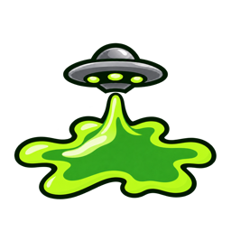

<p align="center">
  
</p>

<h1 align="center">Glee</h1>

<p align="center">
  <strong>Your agents, always on.</strong><br>
  Keep your Mac awake while your agents work—even with the lid closed.
</p>

<p align="center">
  Native macOS app · Swift &amp; SwiftUI · macOS 14+ · Free &amp; open source
</p>

<p align="center">
  <a href="https://github.com/dumpydon/glee/releases/latest">Download for Mac</a> ·
  <a href="#build-from-source">Build from source</a> ·
  <a href="https://github.com/dumpydon/glee/issues">Report a bug</a> ·
  <a href="CONTRIBUTING.md">Contribute</a>
</p>

## See it in action

https://github.com/user-attachments/assets/87fc8c44-03d4-49ee-978f-fb90cfbe3b24

A 19-second look at Glee. Closed-lid mode requires setup and a confirmed active session.

## What it does

Glee lives in your menu bar and keeps your Mac awake for the work you choose: coding agents, downloads, builds, renders, or a long-running script. Start a session, set your limits, and get back to your work.

- **Three ways to stay awake.** Set a timer, pick an end time, or run until you stop.
- **Optional closed-lid mode.** Continue a session with your MacBook closed after a one-time helper setup.
- **Battery controls.** Require a charger, choose a battery cutoff, and set a time limit for closed-lid use on battery.
- **A quiet menu bar.** A simple UFO and puddle symbol, with a small activity dot while a session is running. It follows your Mac's menu bar appearance.
- **Display control.** Let the display sleep or keep it awake with your session.
- **Native Mac experience.** SwiftUI and AppKit, Liquid Glass on supported systems, and launch at login.

Sessions start manually. Glee prevents sleep; it does not monitor your agents or restart their work.

## Get started

**Requires macOS 14 or later. The download supports Apple silicon and Intel Macs.**

1. Download the DMG from [the latest release](https://github.com/dumpydon/glee/releases/latest).
2. Move **Glee.app** to **Applications** and open it.
3. Click the UFO in your menu bar.
4. Choose **Timer**, **Until**, or **Unlimited**, then select **Start session**.

**Glee is free.** There is no account, subscription, activation key, or download fee.

This release is locally signed and is not Apple-notarized. If macOS blocks it, try opening it, then go to **System Settings → Privacy & Security → Open Anyway** and follow your Mac's prompt.

New installations require a charger by default. To run on battery, review **Settings → General → Battery & Power**. Ending a session or quitting releases sleep prevention; sessions do not resume automatically after relaunch or system sleep.

## Keep working with the lid closed

1. Keep the lid open and connect your charger.
2. Click **Set up…** beside **Closed-lid mode**. Finish the helper installation in macOS Installer using your Mac's administrator approval.
3. Return to Glee, start a session, and wait for **Ready to close the lid** before closing your MacBook.

No Apple developer account or paid certificate is needed for this setup. After setup, use the closed-lid switch for future sessions. Battery use is optional and configured in **Settings → Closed Lid**.

Closed-lid mode has a four-hour continuous limit, battery and temperature checks, and a watchdog that restores the previous sleep setting if contact with the app is lost. Use a ventilated surface and test a short session on your own Mac. The activity dot means a session is running; the closed-lid card confirms whether it is ready to close.

If you rebuild or replace the app, run setup again to approve that build. If another sleep utility has a closed-lid helper installed, remove its setup through that utility before setting up Glee.

## Build from source

You'll need **macOS 14 or later**, **Swift 6**, a macOS SDK, and **Python 3**. Xcode with the macOS 26.1 SDK or newer enables Liquid Glass. Command Line Tools with a Swift.org toolchain can build the fallback interface for macOS 14/15.

```sh
git clone https://github.com/dumpydon/glee.git
cd glee
./script/build_and_run.sh --build-only
open dist/Glee.app
```

The script bundles the app, helper, and icons, then signs and verifies the result. Without an Apple signing identity, it creates a local build. Regular sessions work immediately; closed-lid mode uses the administrator-approved setup above.

Run the checks with:

```sh
./script/check.sh
```

See the [development guide](docs/DEVELOPMENT.md) for toolchains, helper setup, packaging, and release options.

## How it's built

| Module | Responsibility |
| --- | --- |
| [`Glee`](Sources/Glee) | SwiftUI controls, the AppKit menu bar popover, preferences, and macOS services. |
| [`GleeCore`](Sources/GleeCore) | Session timing, power rules, and closed-lid lease and recovery logic. |
| [`GleeHelper`](Sources/GleeHelper) | Privileged helper that applies and restores the system sleep setting. |
| [`GleeHelperProtocol`](Sources/GleeHelperProtocol) | Shared XPC interface and authentication between the app and helper. |

Normal sessions use IOKit power assertions. Closed-lid sessions use an approved helper over authenticated XPC. The helper records the previous system sleep setting and restores it when the session ends or a limit is reached.

Preferences stay on your Mac in UserDefaults. This release uses manual updates. A separately configured Apple-signed build can use Sparkle for signed automatic updates.

## A note from the maker

Hi, I'm **dumpydon**. I'm building Glee to make long-running work on a Mac easier to manage. If something is confusing or could work better, I'd love your feedback.

Bug reports, documentation improvements, and pull requests are welcome. Starring the repo or sharing it with someone who might find it useful helps too.

## Contributing

Start with [CONTRIBUTING.md](CONTRIBUTING.md) for the development workflow and what to include in a report.

For bugs, include your Mac model, macOS version, Glee version, and steps to reproduce. For closed-lid issues, also include the charger state and the message under **Setup details**. Leave passwords and personal information out of reports.

## License & acknowledgments

Copyright © 2026 dumpydon.

Glee is licensed under the [GNU Affero General Public License, version 3 only](LICENSE) (`AGPL-3.0-only`). Third-party components retain their own licenses and notices.

Built with Apple's Swift, SwiftUI, AppKit, IOKit, and ServiceManagement frameworks. Optional signed automatic updates use [Sparkle](https://github.com/sparkle-project/Sparkle), whose license is included when bundled. See [NOTICE](NOTICE).
